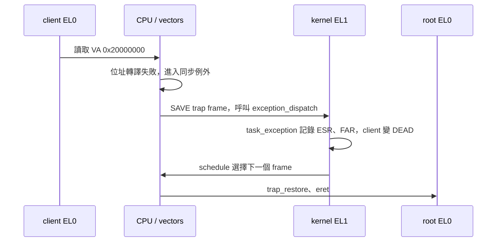
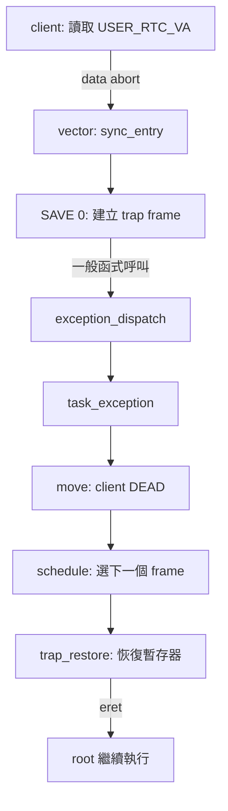

# 00：執行程式並追蹤一次例外

本章沿一個可以實際重現的例子，找出「哪個 task 存取了什麼位址，CPU 為什麼進入核心，以及核心如何保留現場」。task 是可被核心排程的執行單元；本專案的 root、RTC、client 各有一條 thread。先準備兩個 WSL 終端，兩邊都切換到專案根目錄，並執行過 `make all`。常用縮寫可查[術語與縮寫](terms.md)。

## 先辨認三種不同的東西

一個**函式呼叫**會依呼叫慣例傳參數並保存返回位置。**SVC**（Supervisor Call）是 EL0 執行的例外指令，用來進入核心處理服務；**fault** 則是目前指令執行時發生的例外，例如缺少存取權限。SVC 與 fault 都會進 exception vector（例外入口），但原因及後續處理不同。IRQ（Interrupt Request，中斷請求）由裝置或 timer 等來源送達，也走 exception vector。

下面的例子選 `p2-mmio`：client 的位址空間沒有 RTC 的 user mapping。client 嘗試讀取 `0x20000000`，處理器產生 data abort。該次測試中，核心記錄 fault，將 client 設為 DEAD，root 隨後繼續執行。這是刻意安排的隔離測試。



開始之前，先預測：FAR 是被讀取的位址，還是觸發 fault 的指令位址？另外，GDB 的 backtrace 能否保證完整顯示切換前的 EL0 呼叫堆疊？執行後再比較下面的說明。

## 先看完整輸出

```bash
make qemu TEST=p2-mmio
```

在 UART 輸出找到下列欄位。數字依目前測試設定，其中 `elr` 是該次建置的指令位址，可能因程式修改而變動：

```text
[FAULT] role=2 instance=1 esr=0x92000006 far=0x20000000 elr=0x...
[ISOLATION] role=2 ec=36 far=0x20000000 ... continued=1
[TEST] CASE=p2-mmio PASS
```

`role=2` 是 client；`esr` 是保存的 `ESR_EL1`，高位 exception class 為 `(esr >> 26) = 36`，表示來自較低 exception level 的 data abort。對這種 abort，`far` 是觸發存取的虛擬位址；`elr` 是保存的例外返回位置，用來查找觸發指令。不要把所有 exception 的 FAR 都當作有效 fault address，例如此專案的 FP／SIMD access trap 不用 FAR 定位。

`continued=1` 是 root 之後執行 REPORT 時留下的觀察；它和 `[FAULT]` 一起支持「此個案中 root 在 client fault 後繼續」的結論。單看 `[TEST]` marker，無法推論其他未執行的隔離案例也通過。

## 找到指令和入口

1. 在 `user/client.c` 的 `isolation_test()` 搜尋 `CASE_P2_MMIO`，找到從 `USER_RTC_VA` 讀取的敘述。該常數由 `include/uapi.h` 定義為 `0x20000000`。
2. 在 `arch/aarch64/vectors.S` 找低 EL AArch64 synchronous slot。它跳至 `sync_entry`；`SAVE 0` 在目前 kernel stack 建立 trap frame，保存一般暫存器、`SP_EL0`、`ELR_EL1`、`SPSR_EL1`、`ESR_EL1` 和 `FAR_EL1`，再呼叫 `exception_dispatch`。
3. `kernel/exception.c` 的 `exception_dispatch()` 將此例外交給 `task_exception()`。後者依 `kind`、保存的 SPSR 與 ESR 分類，測試個案中對 client 呼叫 `move(current, T_DEAD, 0)`。
4. `schedule()` 回傳被選 task 的 frame；組語 `trap_restore` 依該 frame 恢復狀態並執行 `eret`。

函式呼叫與 exception 不是同一種邊，因此下圖把兩者分開：



## 用 GDB 停在例外入口

第一個終端啟動 QEMU。這個指令會等待 GDB，不會自行開始執行：

```bash
python3 tools/debug_qemu.py --case p2-mmio
```

第二個終端連線：

```bash
gdb-multiarch -q -x tools/gdbinit
```

在 GDB 提示字元逐行輸入：

```gdb
break *task_exception if current == 2 && $x1 == 0 && (((struct trap*)$x0)->esr >> 26) == 36
continue
set $tf = (struct trap*)$x0
p current
p/x $tf->esr
p/x $tf->far
p/x $tf->elr
p/x $tf->spsr
bt 4
continue
```

斷點設在函式**第一條機器指令**，此時 AArch64 呼叫慣例的 `x0` 是 trap frame pointer，`x1` 是 `kind`；條件限制目前 task 是 client、`kind=0` 且 exception class 是 36。範例在目前版本實際停到 `current=2`、`esr=0x92000006`、`far=0x20000000`。`elr`、stack 位址及其他儲存值可能隨編譯改變。第二次 `continue` 後，測試應正常退出。

此範例的 backtrace 顯示 `task_exception` 與 `sync_entry`，但跨 exception 的 stack 不一定能被 GDB 正確展開；若看到 `corrupt stack?`，不能單靠這一行判定核心 stack 已損壞。此處必須對照保存的 frame 與 vectors 程式。專案以 `-O2 -g` 編譯，最佳化也可能讓變數顯示 `<optimized out>` 或讓單步順序與原始碼不同，參見 [GDB 的最佳化程式說明](https://sourceware.org/gdb/current/onlinedocs/gdb.html/Optimized-Code.html) 和 [backtrace 說明](https://sourceware.org/gdb/current/onlinedocs/gdb.html/Backtrace.html)。

除錯時先讀保存值。`ICC_IAR1_EL1` 的讀取會影響中斷狀態，不應為了額外觀察而再讀一次；應使用 handler 已取得的 INTID。暫停與單步也會改變事件交錯，不能直接拿來當延遲量測。

## 自行核對

1. 若 `far` 相同而 `elr` 不同，兩個值各描述什麼？
2. 為什麼 `sync_entry` 跳進 C 之前要先保存暫存器？
3. 為什麼只看到一次 client fault，不足以證明 RTC 的 MMIO mapping 正確？

提示：FAR 描述本例被存取的 VA，ELR 用來定位執行位置；保存 frame 才能在呼叫 C 函式及切換 task 後恢復原狀態；要驗證 RTC 的 mapping，還需觀察 RTC 實際存取裝置的個案。
