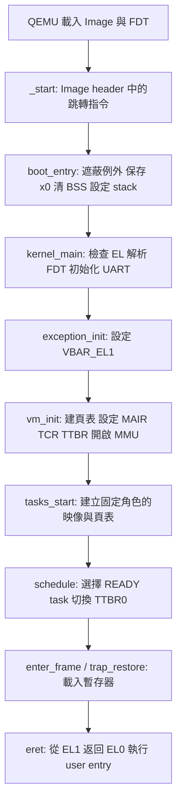
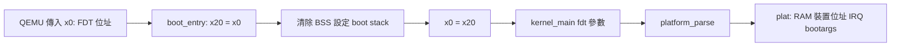
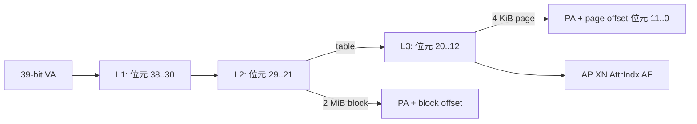
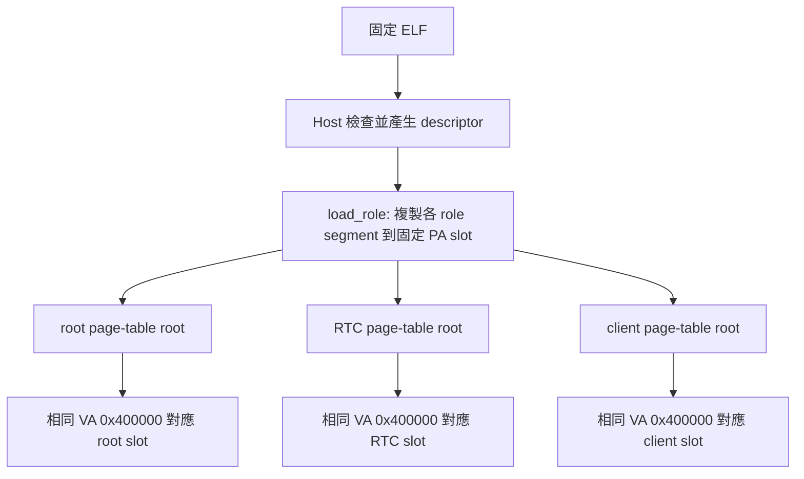
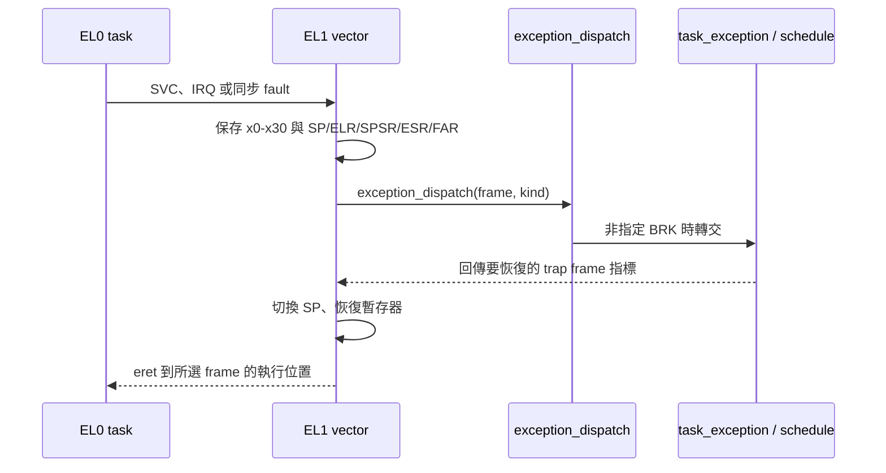

# 從開機到第一個 EL0 task

本章追蹤一條具體路徑：QEMU 將 Image 與 Device Tree 載入記憶體，核心建立頁表與 exception vector，再準備 task 的暫存器並以 `eret` 進入 EL0。FDT（Flattened Device Tree）是平台描述的扁平化表示；MMU（Memory Management Unit）負責位址轉譯和權限檢查。讀完後，應能回答：FDT 位址在哪裡保存？MMU 開啟前後如何繼續取指？同一個 user VA 如何隔離不同 task？例外發生後誰決定下一個執行位置？其他縮寫見[術語與縮寫](terms.md)。

這裡的程式是獨立核心；Image header 參照 [AArch64 Linux boot protocol](https://docs.kernel.org/arch/arm64/booting.html) 的格式，並不表示載入的是 Linux kernel。平台使用 [QEMU virt](https://www.qemu.org/docs/master/system/arm/virt.html)，不是特定實體板子的模擬。

## 1. 先看完整路線



EL1 是核心執行所在的 exception level；EL0 是 user task 執行所在的 level。`eret` 依 `SPSR_EL1` 決定返回時的執行狀態，依 `ELR_EL1` 決定返回位址。上圖描述一般 task 情境：`p0-boot` 在 MMU 初始化前結束；`p1-vm` 在 MMU 與 BRK 測試後結束。

## 2. 執行並觀察開機

在 WSL 的專案目錄執行：

```sh
make all
make qemu TEST=p1-vm
```

一次實際執行的輸出節錄：

```text
[BOOT] el=1 fdt=0x48000000 size=1048576
[PLATFORM] ram_base=0x40000000 ram_size=0x20000000 uart=0x9000000 rtc=0x9010000 gicd=0x8000000 gicr=0x80a0000 rtc_irq=34 timer_irq=30
[VM] enabled=1 granule=4096 root=0x40094000 high_pc=0xffffff80400851cc text_ro=1 data_xn=1 reserved=1
[EXCEPTION] el=1 ec=60 recovered=1
```

`fdt`、`root` 與 `high_pc` 是這次映像和 QEMU 配置下觀察到的位址；程式變更後不應把它們當成固定值。`ram_base`、裝置位址與 IRQ 是此平台實際解析的結果，應以自己的輸出及 DTB 為準。`p1-vm` 的 PASS 表示該次個案通過其檢查，不代表所有位址空間情境都已驗證。原始輸出及 command 保存在工具印出的 report 路徑附近。

## 3. Image 入口如何交給 C 程式

對照 [boot.S](../../arch/aarch64/boot.S) 與 [kernel.ld](../../linker/kernel.ld)：

1. linker 將 `_start` 放在 `0x40080000`。前 64 bytes 是 Image header，第一條指令是 `b boot_entry`；header 的 `text_offset` 為 `0x80000`，magic 為 `ARM\x64`。
2. QEMU 在 x0 提供 FDT 位址。`boot_entry` 先將 x0 存到 x20，因為清除 BSS 的迴圈會使用其他暫存器。
3. `msr daifset, #15` 遮蔽 D、A、I、F 類例外。程式將 `__bss_start` 到 `__bss_end` 清零，接著把 SP 設成 `boot_stack_top`。啟動 stack 配置為 32 KiB。
4. 把 x20 放回 x0，呼叫 `kernel_main`。依 AArch64 calling convention，第一個整數參數由 x0 傳入。

啟動程式的關鍵指令如下；中間的 BSS 清除迴圈在此省略，完整程式見 [boot.S](../../arch/aarch64/boot.S)：

```asm
msr daifset, #15
mov x20, x0
// 此處執行 BSS 清除迴圈
ldr x1, =boot_stack_top
mov sp, x1
mov x0, x20
bl kernel_main
```

`msr daifset` 設定遮蔽位元；`mov x20, x0` 保存入口參數；在有效 stack 建立後才以 `bl` 呼叫 C 函式。省略的清除迴圈會影響可用的記憶體內容，不能將這段摘錄獨立當作可執行的完整入口。



可用下列指令檢查 ELF 的 entry 和 segment flags，並觀察反組譯的入口：

```sh
aarch64-linux-gnu-readelf -hW -lW build/kernel.elf
aarch64-linux-gnu-objdump -d build/kernel.elf | head -80
```

ELF 的 RX、R、RW segment 權限是連結產物的描述；執行時的存取權限還必須由頁表實際設定。兩者不能互相代替。

## 4. FDT 的資料從哪裡流向哪裡

`kernel_main` 先讀 `CurrentEL`，只接受 EL1；再檢查 FDT pointer 是否位在預期 RAM 範圍，將 pointer 和最多 2 MiB 可讀範圍傳給 `platform_parse`。解析器寫入全域 `plat`，之後 UART 初始化與頁表／IRQ 初始化使用 `plat` 的欄位。

| 來源 | `plat` 欄位 | 接收者或用途 |
|---|---|---|
| memory node | `ram_base`、`ram_size` | 頁表與固定 task frame 範圍檢查 |
| PL011 node | `uart_base` | `console_init`，用於輸出 log |
| PL031 node | `rtc_base`、`rtc_irq` | 核心 device mapping、RTC task mapping 與中斷路徑 |
| GIC node | `gicd_base`、`gicr_base` | GIC distributor／redistributor |
| timer node | `timer_irq` | physical timer 的 PPI |
| `/chosen` | `bootargs` | 選擇個案，例如 `case=p1-vm` |

本解析器接受受控 schema，不是完整通用的 Device Tree 實作。裝置必須位於 root 或只有空 `ranges` 的祖先 bus；解析器也檢查 interrupt controller 和 parent，並拒絕與核心保守區或固定 task slot 衝突的 reserve map。boot entry 在解析前已清除 BSS，因此此檢查不能避免所有啟動期寫入。可把建置時匯出的 DTB 轉回文字比對，但仍應以該次 guest 的 FDT 和輸出判斷：

```sh
dtc -I dtb -O dts build/platform.dtb -o build/platform.dts
```

先預測：若 UART 位址尚未解析成功，能否依賴 UART 印出解析失敗？再讀 `kernel_main` 的呼叫順序：`platform_parse` 失敗時早於 `console_init`，因此應查 process exit code，而不是只等 UART 訊息。

## 5. MMU：由 VA 查表取得 PA 和權限

虛擬位址（VA）是 CPU 指令使用的位址；實體位址（PA）是轉譯結果。本專案核心在 EL1 使用 identity mapping：核心正常執行時的 VA 與 PA 相同。MMU 仍會檢查頁表權限；相同數值不代表繞過轉譯。



每張 4 KiB 頁表有 512 個 8-byte descriptor。`leaf` 使用各級 9 個 index bits；L2 descriptor 可以直接描述 2 MiB block，L3 descriptor 描述 4 KiB page。

以 root 的 VA `0x00400123` 為例，可先手算各級 index：

| 層級 | 計算 | 結果 |
|---|---|---:|
| L1 | `(0x00400123 >> 30) & 0x1ff` | `0` |
| L2 | `(0x00400123 >> 21) & 0x1ff` | `2` |
| L3 | `(0x00400123 >> 12) & 0x1ff` | `0` |
| page offset | `0x00400123 & 0xfff` | `0x123` |

在本次建置中，`readelf -lW build/user/root.elf` 顯示可執行 segment 從 VA `0x00400000` 開始，`load_role()` 將第一個 segment 配在 root slot 的 BootInfo 頁之後，也就是 PA `0x41001000`。因此本例若使用這個 root 的頁表，資料所在 PA 為 `0x41001000 + 0x123 = 0x41001123`。這是依目前 segment 順序和配置推導；修改映像後應重新查 ELF 與 `load_role()`，也不能把包含權限 bits 的 descriptor 原值直接當成 PA。

`vm_init` 使用固定的 128 頁 page-table pool。RAM 大部分先用 2 MiB block 映射，核心映像所在的第一個 2 MiB block 改成 4 KiB page，讓 text、rodata 和 data 有不同權限。text 為 RX；rodata 為 R 且不可執行；data／BSS 為 RW 且不可執行。UART、RTC 與 GIC 映射為 Device memory。這些設定由 `vm_pte_encode` 和呼叫端共同決定，詳見 [vm.h](../../include/vm.h) 與 [vm.c](../../arch/aarch64/vm.c)。

控制流程依序寫入 `MAIR_EL1`、`TCR_EL1`、`TTBR0_EL1` 和 `TTBR1_EL1`，執行同步與 TLB 維護，再設定 `SCTLR_EL1` 的 MMU、cache 與 WXN 位元。`dsb`、`isb` 和 `tlbi` 各有不同責任：不能將它們都當作一般的編譯器屏障。要研究精確順序，從 `vm_init` 的 inline assembly 逐條對照。

此版也讓 TTBR1 提供高位址 alias。`vm_high_probe` 是在高位址執行的一個 leaf routine，用來觀察高位址取指；其餘核心程式仍以 identity mapping 執行，不能據此宣稱整個核心已連結在高位址。

## 6. 三個 task 為何可以使用相同 user VA

Host 先編譯 root、RTC、client 的固定 ELF。`tools/pack_users.py` 驗證 ELF segments、對齊、範圍和 W+X 限制，再產生描述資料；核心只載入這些固定描述，不接受任意 runtime ELF。



每個角色的 PA slot 是 `0x41000000 + role * 0x20000`，各 128 KiB。role 編號依序為 root 0、RTC 1、client 2。`vm_new_root` 為各角色建立獨立的低位址頁表；核心 RAM 映射則共用且不可從 EL0 存取。排程切換時 `vm_activate` 更新 TTBR0 並執行 TLB 同步。相同 VA 的隔離依賴「目前選中的頁表 root」與「該 root 中的 descriptor」，不能只看 VA 數值。

| User VA | 內容與權限 |
|---|---|
| `0x003ff000` | BootInfo，唯讀且不可執行 |
| `0x00400000` 起 | 固定 ELF segment；依 segment flags 映射 |
| `0x007fb000` | stack guard，未映射 |
| `[0x007fc000, 0x00800000)` | 四頁 user stack，RW 且不可執行 |
| `0x20000000` | 僅 RTC task 映射的 PL031 MMIO |

`load_role` 同時在各自的 kernel stack 建立 `struct trap`：`elr` 指向 user image entry、`sp` 指向 user stack top、`x[0]` 指向 BootInfo。複製程式碼後 `sync_code` 清理 D-cache 到 PoU，並做 I-cache invalidation 與同步，再讓 CPU 執行這些位元組。

## 7. 從 `eret` 回到例外入口

`enter_frame` 將 SP 切到所選的 trap frame；`trap_restore` 依序恢復 `SP_EL0`、`ELR_EL1`、`SPSR_EL1` 與 x0–x30，最後執行 `eret`。第一次進入 task 時，這個 frame 是核心預先建立的；後續 exception 則由 vector 的 `SAVE` 建立 frame。



圖中的最後一個 task 不一定是進入 exception 前的 task。frame 指標由 C 端回傳，assembly 會將 SP 設為該指標；這是切換執行脈絡的關鍵。`struct trap` 共 288 bytes，其欄位與組語 offset 定義在 [trap.h](../../include/trap.h)。

`p1-vm` 額外執行 `vm_brk_test`。它的已知 BRK 由 `exception_dispatch` 識別，將保存的 ELR 加 4，從下一條 AArch64 指令繼續；這是針對該已知測試點的處理，不能推論所有 BRK 或 EL1 fault 都可恢復。

## 8. 實際追蹤：client 存取 RTC VA

```sh
make qemu TEST=p2-mmio
```

這個個案在 client EL0 讀取 `0x20000000`。該 VA 只在 RTC 的頁表映射；目前執行的是 client，使用 client 自己的 TTBR0，所以產生 data abort。一次執行的輸出節錄：

```text
[FAULT] role=2 instance=1 esr=0x92000006 far=0x20000000 elr=0x40037c
[ISOLATION] role=2 ec=36 far=0x20000000 svc=7 invalid_syscall=1 bad_pointer=1 continued=1
```

從 `ESR_EL1 >> 26` 可得 EC 36（十六進位 `0x24`），表示由較低 exception level 產生的 data abort；這筆 `FAR_EL1` 是嘗試存取的 VA。ELR 是本次 fault 的指令位址，會隨 user 程式重新編譯而改變。核心在此測試中將 client 設為 DEAD，root 恢復後才輸出 `continued=1`。此觀察驗證本個案的隔離路徑，不表示所有可能的 user fault 都可恢復。

要在 GDB 查現場，先在一個 terminal 執行：

```sh
python3 tools/debug_qemu.py --case p2-mmio
```

另一個 terminal 在專案根目錄執行 `gdb-multiarch -q -x tools/gdbinit`。在 GDB 使用：

```gdb
break *task_exception if current == 2 && $x1 == 0 && (((struct trap *)$x0)->esr >> 26) == 36
continue
set $tf = (struct trap *)$x0
p/x $tf->esr
p/x $tf->far
p/x $tf->elr
p/x $tf->spsr
p current
p/x task[2].root
```

斷點下在函式第一條指令，所以 x0、x1 仍分別是 frame 指標和 kind。若沒命中，先確認選用 `p2-mmio`、GDB 已連接正確 port，並檢查 `build/kernel.elf` 與啟動用 Image 是否來自同次建置。GDB 單步會改變時序；其暫停時間不是程式實際延遲量測。
