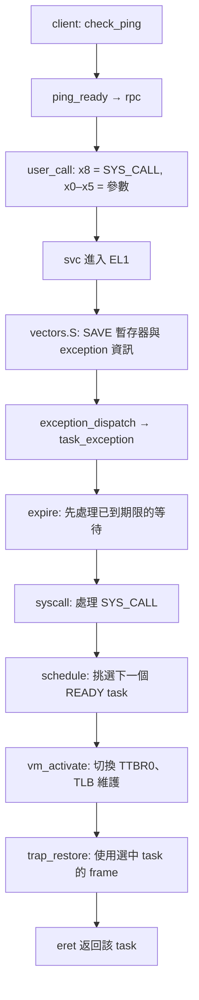
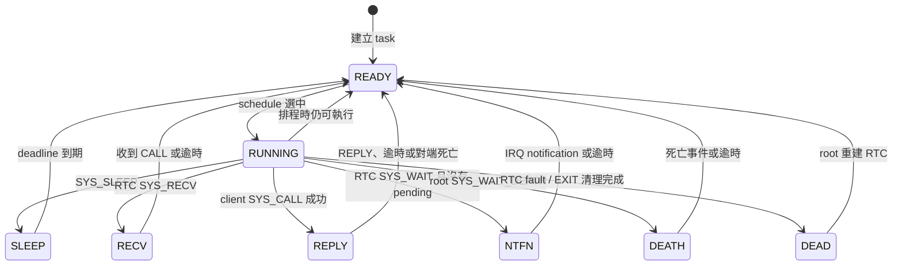
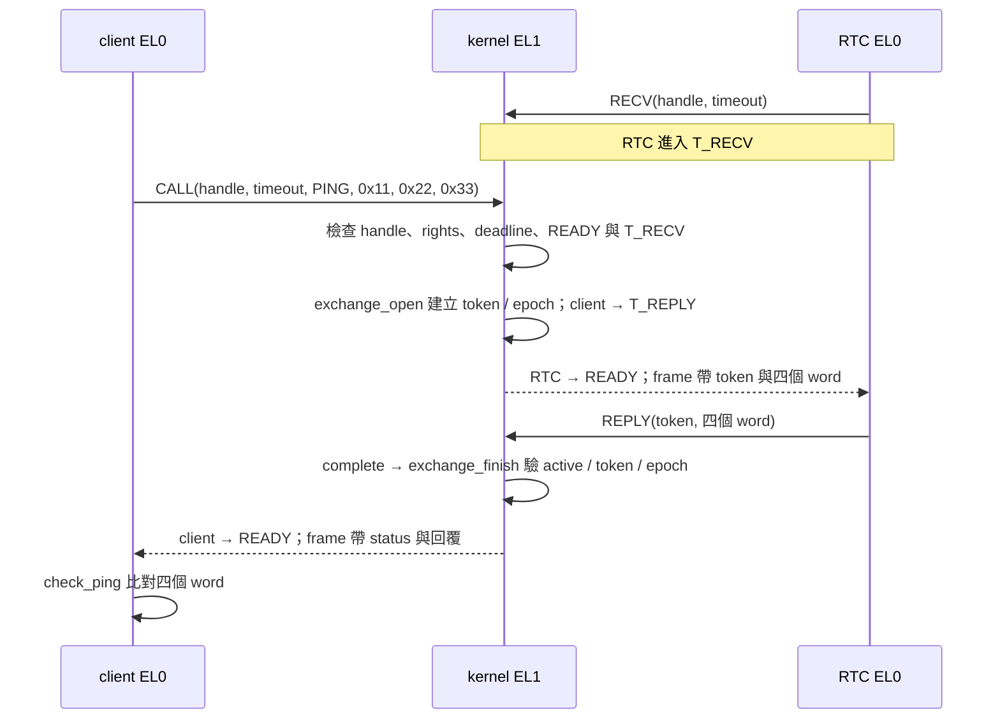
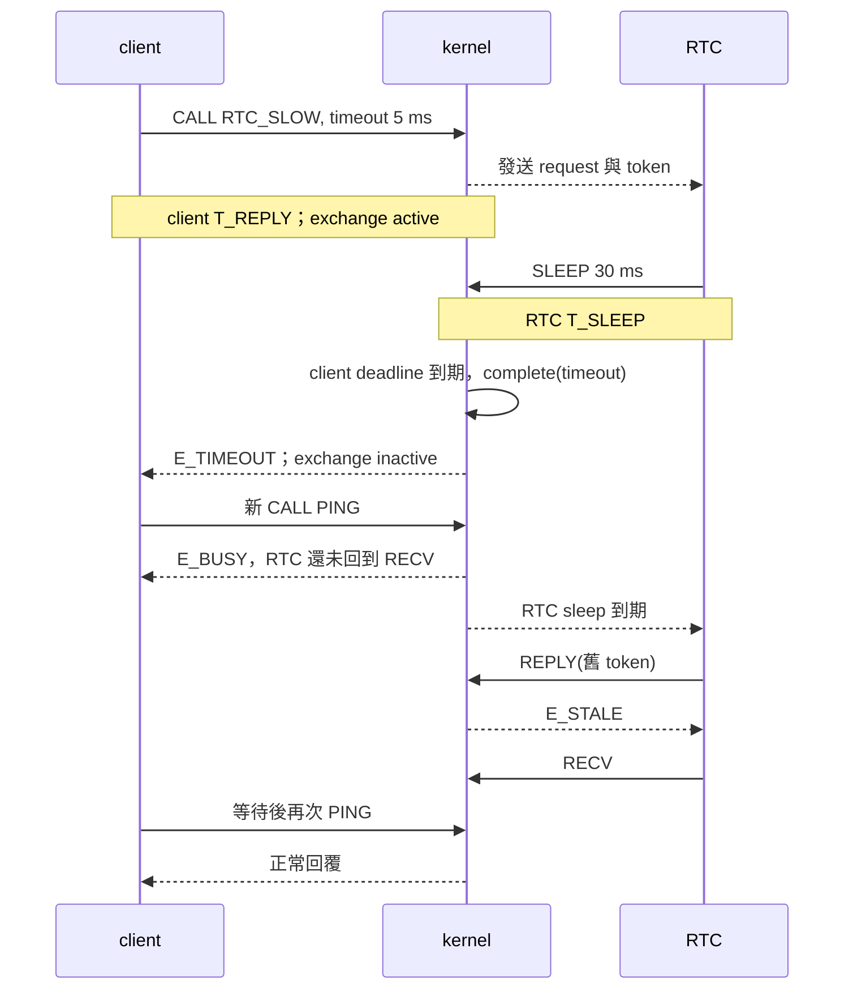

# 排程、等待與同步 IPC

這一章追蹤一次 user request 如何進入核心、使兩個 task 改變狀態，最後把結果送回呼叫端。IPC（Inter-Process Communication）指執行單元之間的通訊；本專案使用同步的 request／reply。先看 `PING` 的成功路徑，再看等待逾時後的晚回覆。閱讀時，把「目前執行哪個 task」、「誰在等待」及「哪筆請求仍有效」分開記錄；其他縮寫見[術語與縮寫](terms.md)。

主要程式位置：

| 位置 | 閱讀重點 |
|---|---|
| [include/uapi.h](../../include/uapi.h) | syscall 編號、暫存器介面、回傳碼 |
| [arch/aarch64/vectors.S](../../arch/aarch64/vectors.S) | exception 入口保存暫存器，切換至另一份 frame |
| [kernel/task.c](../../kernel/task.c) | 例外分派、計時、排程、IPC 和權限檢查 |
| [kernel/state.c](../../kernel/state.c) | 狀態及單筆 exchange 的操作 |
| [user/common.h](../../user/common.h)、[user/client.c](../../user/client.c)、[user/rtc.c](../../user/rtc.c) | user 呼叫、測試請求與服務處理 |

## 1. 一次 syscall 經過哪些位置

以 `check_ping()` 為入口，先讀 [user/common.h](../../user/common.h) 中的 `check_ping()`、`ping_ready()`、`rpc()`；再讀 [include/uapi.h](../../include/uapi.h) 的 `user_call()`。`user_call()` 把 syscall 編號放在 x8、最多六個參數放在 x0–x5，執行 `svc #0`。SVC 造成 EL0 到 EL1 的同步例外。



`SAVE` 把 x0–x30、SP_EL0、ELR、SPSR、ESR、FAR 存成 `struct trap`；對照 [include/trap.h](../../include/trap.h)。`task_exception()` 把這個 frame 記到目前 task，最後 `schedule()` 回傳下一個 task 的 frame。組語將 stack pointer 換到回傳的 frame，再恢復暫存器及執行 `eret`。因此返回時執行的 task 可以和進入時不同。

注意：C 呼叫樹只能描述當前 kernel stack 上的呼叫。task 先阻塞、之後透過已保存 frame 恢復時，不能要求單次 `backtrace` 同時呈現兩個 task 的 user 呼叫鏈。

## 2. 狀態與排程

三個正式 role 的優先權依序是 root 0、RTC 1、client 2；數字越小越優先。`schedule()` 在固定大小的 task 表中掃描 READY 項目，沒有獨立 runqueue 節點；沒有 READY 的 user task 時選 EL1 idle，執行 `wfi`。P2 隔離測試例外地使用合作式輪轉；本章的 P3 之後案例使用固定優先權。



這張圖列出主要轉移；例如 RTC 的 fault 可發生於不同 user 執行位置，清理時需結束它原有的等待。`task[id].wait` 只有一個 primary state；`SLEEP`、`RECV`、`REPLY`、`NTFN`、`DEATH` 都有非零 deadline，`READY`、`RUNNING`、`DEAD` 不帶 deadline。`move()` 呼叫 `state_move()`；`invariant()` 在排程時檢查 deadline、RUNNING 數量及 active exchange 等條件。

Physical timer 使用 counter ticks。`deadline_ms()` 將 1–10000 ms 換成絕對 ticks；`arm_timer()` 取目前時間加 5 ms 與各等待 deadline 的較早者。例外到來時，`task_exception()` **先**呼叫 `expire(timer_now())`，再處理 IRQ 或 syscall；本次檢查時間 `now >= deadline` 時先判逾時。這是程式採用的事件順序，不代表能以這個模擬環境推定真實硬體的延遲。

執行 `make qemu TEST=p3-sched`，觀察 `[SCHED]` 的 `timer_irq`、`preemptions` 與 `sleep_wake`；`p3-idle` 則觀察 `idle`。計數受實際時序影響，不要求每次相同。單獨執行的 PASS 檢查程序與輸出條件；`make test-p3` 還會執行個案語意檢查與 host 狀態測試。

## 3. 一次 PING 的資料流

`SYS_CALL` 的 x0 是 endpoint handle、x1 是 timeout 毫秒，x2–x5 是四個 64-bit word。PING 範例的內容依序是 `RTC_PING`、`0x11`、`0x22`、`0x33`。這些值複製到 RTC 的保存 frame，不是兩個 task 共用一塊 user buffer。



逐項對照 `SYS_CALL` 分支：

1. `capability()` 檢查 handle 的物件類型與權限。client 的 endpoint handle 1 有 CALL 權限；RTC 的 endpoint handle 1 有 RECV／READY 權限。不存在或類型錯誤回 `E_BAD_HANDLE`，物件類型正確但缺權限回 `E_RIGHTS`。
2. RTC 已死亡回 `E_PEER_DIED`；尚未 READY 回 `E_NOT_READY`；RTC 不在 `T_RECV` 或 exchange 已 active 時回 `E_BUSY`。這裡沒有等待送出的 queue。
3. `exchange_open()` 將 sequence 加一作為 token，記錄 client 與目前 epoch，將 active 設為 true；sequence 已到最大值時拒絕再開新請求。
4. 核心將 token 放入 RTC frame 的 x1、四個 request word 放入 x2–x5，喚醒 RTC；client 轉為 `T_REPLY`，並帶自己的 deadline。
5. RTC 從 `SYS_RECV` 的回傳值讀取 token 和資料。處理完成後 `SYS_REPLY` 傳入 token 及四個結果；`complete()` 驗證成功後，將 syscall status 寫入 client frame 的 x0、回覆 word 寫入 x1–x4，再把 client 喚醒。

`user_call()` 將 x0 轉為 signed `status`，把 x1–x5 放入 `word[0..4]`。一般服務回覆可在第一個 reply word 放服務自己的錯誤碼；這個值與 x0 的 syscall status 是不同層次。PING 測試則用四個回覆 word 直接比對原始值。

## 4. 逾時後為什麼要拒絕晚回覆

`p4-ipc` 先送 `RTC_SLOW`，client 的 CALL timeout 是 5 ms；RTC 收到後睡眠 30 ms。以下畫出此筆請求的關鍵順序，圖中時間是測試指定的等待長度，並非實際執行時間測量。



`complete()` 透過 `exchange_finish()` 檢查 active、token、epoch，成功時才將 active 清除並喚醒 client。第一次完成之後，舊 token 不能再完成同一筆請求；未來若開始新請求，遞增 sequence 與 epoch 檢查也避免把舊回覆套到新 exchange。若先發生 RTC 死亡，清理路徑使用同一個完成入口送出 `E_PEER_DIED`。在這個單核心實作中，例外處理期間 IRQ 遮蔽；事件仍可能在不同例外之間交錯，因此必須明確規定完成順序。

Client timeout 只結束它自己的等待，不撤銷 RTC 已接收的操作。RTC 自己的 `T_SLEEP` 或 `T_NTFN` 有獨立狀態與 deadline；RTC 在收尾後呼叫 REPLY，即使得到 `E_STALE` 也要回到 RECV。裝置 alarm 的具體時序見其他章節。

## 5. 從輸出走回原始碼

在 WSL 專案根目錄執行：

```sh
make qemu TEST=p4-ipc
make test-p4
```

一次實際執行的摘要如下，計數是該次結果；`timer_irq` 等時序相關值會變動：

```text
[IPC] calls=3 replies=2 busy=1 timeout=1 stale=1 denied=4 completed=3 once=1
[TEST] CASE=p4-ipc PASS
```

按下列順序查證，比直接從 PASS 推論整個系統正確更精確：

1. 在 `user/client.c` 找 `ipc_test()`，核對 bad handle／rights、PING、慢請求、逾時後的 BUSY 與後續 PING。
2. 在 `user/rtc.c` 找 `RTC_SLOW`，確認服務睡眠及收到 `E_STALE` 的檢查。
3. 在 `kernel/task.c` 查 `SYS_CALL`、`SYS_REPLY`、`expire()` 與 `complete()`，比對統計各自在何處增加。
4. 確認 `calls == completed`，且這個案例沒有 peer death，因此 `completed == replies + timeout`。`once=1` 表示 report 前的 runtime invariant 檢查未失敗，不是列舉所有可能交錯的證明。
5. 查 `build/reports/gates/p4-ipc.json` 和其 evidence 欄位指向的實際輸出；`p4-ipc-model` 的 host 測試以不同事件標籤呼叫共同完成函式，檢查重複完成與舊 token。它沒有執行 reply、timeout、death 各自的核心分支，無法取代 guest 的 trap 和切換路徑。

## 6. 用 GDB 觀察 CALL 入口

準備兩個 WSL terminal，第一個執行：

```sh
make all
python3 tools/debug_qemu.py --case p4-ipc
```

第二個在專案根目錄執行 `gdb-multiarch -q -x tools/gdbinit`，接著在 GDB 輸入：

```gdb
break *task_exception if current == 2 && $x1 == 0 && ((struct trap *)$x0)->x[8] == 4
continue
set $tf = (struct trap *)$x0
p/x $tf->esr
p/x $tf->x[0]
p/d $tf->x[1]
p/x $tf->x[2]
p/x $tf->x[3]
p/x $tf->x[4]
p/x $tf->x[5]
p rpc
p task[1].wait
p task[2].wait
bt
```

斷點設在函式第一條指令，此時 x0 是 frame 指標、x1 是 kind；條件限制 client 的同步例外，且保存的 x8 為 `SYS_CALL`。先到的 CALL 可能是 `ipc_test()` 的無效 handle 測試，不能假定第一個命中就是 PING。`$tf->x[0]` 至 `[5]` 是進入前的參數；`rpc` 與兩個 wait 在這個斷點顯示的是**處理當次 CALL 之前**的狀態。

用 `continue` 找下一次 CALL，或讀取 `x[2]` 分辨 request。若要追 `complete()`，可設 `break complete` 再繼續，但 optimized build 可能將函式 inline 或使區域變數顯示為 optimized out；可先用 `info breakpoints` 確認斷點，必要時改在 [kernel/task.c](../../kernel/task.c) 的對應原始碼行設斷點並查看 `disassemble /m`。`step` 逐來源行進入呼叫，`next` 跨過呼叫，`stepi` 逐指令；在中斷與 context switch 周圍，指令級追蹤通常較容易看清真正切換點。GDB 停機會影響觀察到的時間，避免將單步結果當成 timeout 的效能測量。指令行為可查 [GDB 手冊：斷點與單步](https://sourceware.org/gdb/current/onlinedocs/gdb.html/Continuing-and-Stepping.html)及 [backtrace](https://sourceware.org/gdb/current/onlinedocs/gdb.html/Backtrace.html)。

## 7. 自行推演

1. RTC 正在處理前一筆已逾時的請求，client 再次 CALL 時，哪個狀態使核心回傳 `E_BUSY`？
2. 依目前程式，若例外進入時 `now` 已等於 client deadline，接著才處理 REPLY，哪一方先取得完成權？
3. 若 client 送出的 handle 不存在，`rpc.active` 是否會變成 true？請沿 `SYS_CALL` 的分支確認。

核對：第一題是 RTC 尚未回到 `T_RECV`；第二題由 `expire()` 先處理 timeout，晚到的 REPLY 得到 `E_STALE`；第三題權限檢查先返回錯誤，不會執行 `exchange_open()`。
