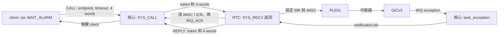
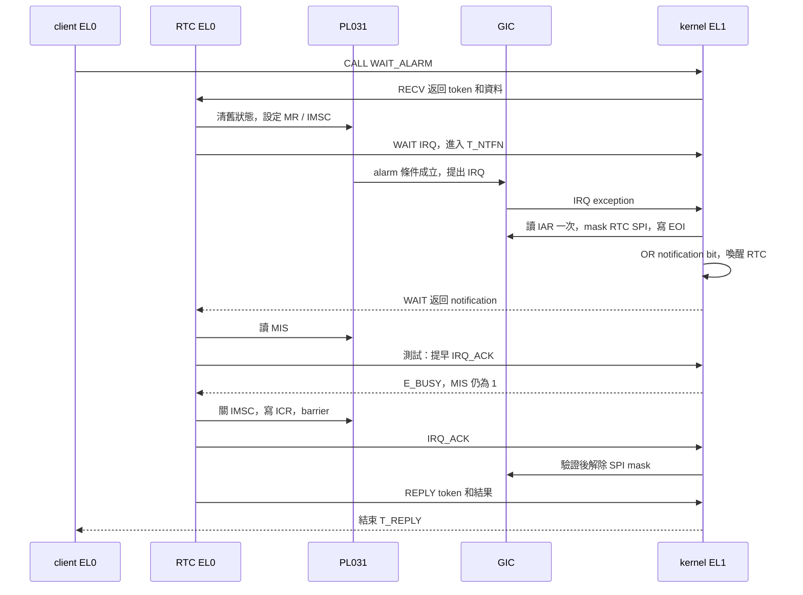
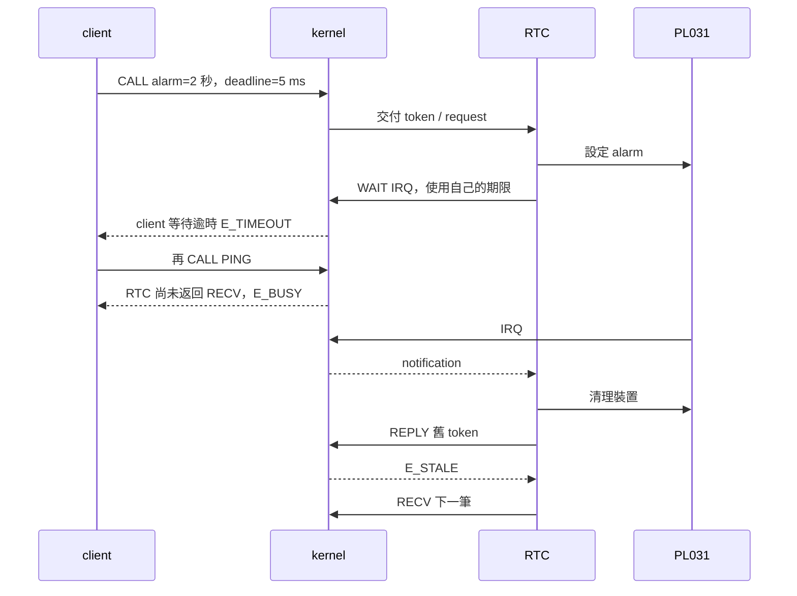
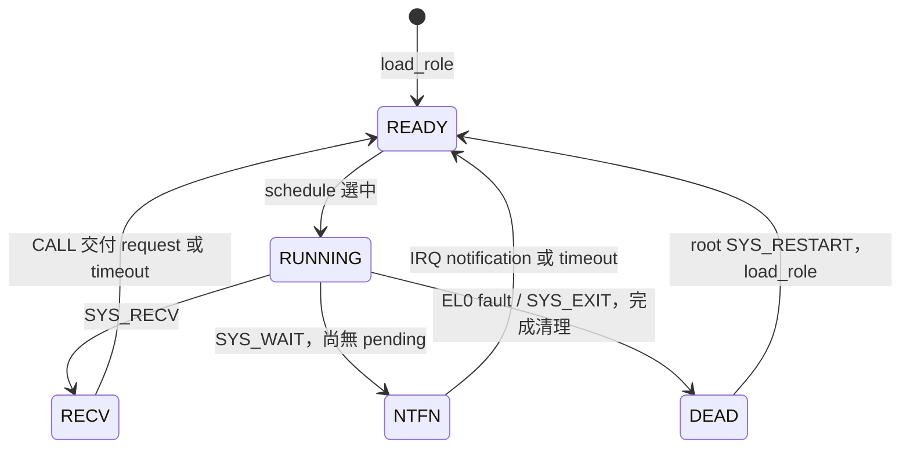

# RTC 中斷、等待與重啟

本章沿著一筆 `WAIT_ALARM`，追蹤資料如何從 client 進入 RTC、裝置如何通知核心，以及 RTC 在中途中止後如何恢復。建議先讀 `user/client.c`、`user/rtc.c`，再看 `kernel/task.c` 的 `syscall()`、`task_exception()`、`rtc_fault()` 和 `load_role()`。硬體中斷的暫存器操作在 `arch/aarch64/irq.c`。

先建立一個觀念：**裝置狀態、GIC 狀態、核心 notification 與 thread 狀態是四種不同的狀態**。它們彼此影響，但清除其中一個不等於另外三個也已清除。

## 一筆 alarm 的資料流



`user/common.h` 的 `rpc(timeout, op, a, b, c)` 將四個資料 word 放在 `SYS_CALL` 的 x2–x5：第一個是操作碼 `RTC_WAIT_ALARM`，第二個是秒數。核心在 `SYS_CALL` 檢查 handle、deadline、服務狀態及 `T_RECV` 後，建立 exchange，將 token 寫入 RTC 保存的 x1、四個 word 寫入 x2–x5，然後喚醒 RTC，讓 client 進入 `T_REPLY`。

RTC 的 `SYS_RECV` 返回時，`request.word[0]` 對應 x1，存放 token；`request.word[1]` 對應 x2，是操作碼；`request.word[2]` 對應 x3，是秒數。`wait_alarm()` 完成後，RTC 用 `SYS_REPLY` 將 token 與四個回覆 word 交給核心。client 收到的 x0 是 **syscall status**，回覆資料第一個 word 則存放服務操作的結果。例如 syscall 可以成功返回 `E_OK`，而服務回覆的第一個 word 是 `E_INVAL`；兩者不能混為一談。

## RTC 就緒及暫存器

啟動與重啟都從 `user/rtc.c` 的 `user_main()` 開始。RTC 關閉 IMSC、寫 ICR 清除舊中斷，設定 CR，執行 `dsb sy`，然後呼叫 `SYS_READY`。核心驗證 endpoint 權限，確認 IMSC 和 RIS 都為 0，才記錄 `irq_instance`、設定 `endpoint_ready` 並解除 SPI mask。READY 成功之後，RTC 才能進入 RECV。

RTC 在 EL0 的 `boot->rtc_va` 是 `0x20000000`，僅 RTC 的頁表映射此裝置。下表的 offset 相對於該虛擬位址；核心則使用 FDT 提供的 `plat.rtc_base`。本機既有 QEMU 輸出中 physical base 為 `0x09010000`，仍應以本次執行的 `[PLATFORM]` 為準。

| 暫存器 | Offset | 本程式的用途 |
|---|---:|---|
| DR | `0x00` | 讀取目前 RTC 秒數 |
| MR | `0x04` | 設定 alarm 比對值 |
| CR | `0x0c` | 啟用 RTC |
| IMSC | `0x10` | 控制裝置中斷是否輸出 |
| RIS | `0x14` | 讀取原始中斷狀態 |
| MIS | `0x18` | 讀取經 IMSC 遮蔽後的中斷狀態 |
| ICR | `0x1c` | 寫入 1 清除裝置中斷 |

`wait_alarm()` 接受 1–3 秒；超出範圍立即回覆 `E_INVAL`。有效請求先寫 IMSC=0、ICR=1，再把 `DR + seconds` 寫入 MR，設定 IMSC=1 並執行 barrier。RTC 隨後呼叫 `SYS_WAIT`；一般等待上限是 `(seconds + 2) * 1000` 毫秒。

這裡的 RTC DR/MR 是裝置秒數，等待 deadline 則由核心的 architected counter 計算。不要將兩者直接相減作為精確時間量測。DR 為秒粒度，寫入 `DR + 1` 到觸發的實際經過時間也不保證剛好一秒。

## IRQ 到達後發生什麼事



核心由 `task_exception()` 呼叫 `irq_acknowledge()` 讀取 `ICC_IAR1_EL1` 一次，將得到的 INTID 存在局部變數 `id`。讀 IAR 會改變 GIC 的 active 狀態，因此追蹤時應觀察既有的 `id`，不要為了印值再讀一次 IAR。若是 RTC IRQ，核心先 `irq_disable()` 遮蔽 SPI、再 `irq_eoi()`，接著將 `IRQ_BIT` OR 進 `task[1].pending`。EOImode 0 的 EOI 同時執行 priority drop 和 deactivate；它不會代替 RTC 寫 ICR。

對照 [kernel/task.c](../../kernel/task.c) 的 RTC IRQ 分支，主要順序如下：

```c
irq_disable(id); rtc_masked = true; ++stats.irq;
irq_eoi(id);
if (endpoint_ready && irq_instance == task[1].instance && task[1].wait.state != T_DEAD) {
    task[1].pending |= IRQ_BIT;
    /* 後續依 RTC 的等待狀態決定是否喚醒。 */
}
```

這是摘錄；實際程式也會在 `T_NTFN` 時寫入返回 frame 並呼叫 `wake()`。先 mask 和 EOI 處理的是 GIC，`pending` 則是核心留給 RTC 的通知。

若 RTC 已處於 `T_NTFN`，核心把 pending bits 複製到 RTC 的返回 x1、清除這些 bits，並將 RTC 喚醒。若 IRQ 先於 `SYS_WAIT` 到達，bits 留在 `task[1].pending`；後續 WAIT 直接取走並清除。多次事件以 OR 合併，因此不能把 notification 當成逐筆計數佇列。

RTC 醒來後先驗 notification bit 和 MIS。測試程式會刻意在 MIS=1 時先呼叫一次 `SYS_IRQ_ACK`，預期得到 `E_BUSY`；這是在驗證錯誤順序確實被拒絕。之後 RTC 才關 IMSC、寫 ICR、執行 `dsb sy` 並再次 ACK。核心檢查 handle、instance、binding 與 MIS；接受 ACK 時會清除核心 pending bits 並解除 SPI mask。

要注意，**MIS=0 不足以證明 ICR 已清除**：只要 IMSC 關閉，MIS 就可能為 0，RIS 仍可為 1。裝置清理依賴 RTC 執行 ICR 寫入；新 instance 的 READY 另行檢查 RIS。這也是觀察時要同時區分 RIS 和 MIS 的原因。

## 兩個 deadline 與晚回覆

client 的 `T_REPLY` 與 RTC 的 `T_NTFN` 是各自的等待，分別保存 deadline。client timeout 時，`expire()` 透過 `complete()` 完成該筆 call 並喚醒 client；它沒有取消 MR，也沒有解除 RTC 對裝置操作的責任。RTC 仍可在自己的期限內收到 IRQ、清理裝置並嘗試 REPLY；此時 exchange 已完成，舊 token 得到 `E_STALE`。



在 `task_exception()` 中，核心先呼叫 `expire(timer_now())`，再處理當次 syscall 或 IRQ；deadline 相等時由 timeout 先取得完成機會。`exchange_finish()` 同時驗證 active、token、epoch；完成後清除 active。`complete()` 是 reply、timeout、peer death 共用的完成點，以避免同一筆 call 重複喚醒。

## 故障清理與 root 重建

以 `p6-pending` 為例：第一個 RTC instance 已收到 IRQ 並確認 MIS=1，尚未關閉 IMSC、寫 ICR，測試就刻意讀取未映射的 `0x1000`。這是**測試注入的 fault**，用來檢查清理順序；不應把該次注入本身當作偶然發現的缺陷。



圖中節點對應 `T_READY`、`T_RUNNING`、`T_RECV`、`T_NTFN`、`T_DEAD`。新 instance 的 thread 先成為 `T_READY`，被選中後進入 `T_RUNNING` 執行初始化；endpoint 要等 `SYS_READY` 成功後才對 CALL 開放。圖僅列本案例涉及的主要轉移。

沿著 `rtc_fault()` 讀下列順序：

1. 遮蔽 RTC SPI，設定 `rtc_masked`。若有 active exchange，以原 token 和舊 epoch 完成 `E_PEER_DIED`。
2. 關閉 endpoint、清除 IRQ instance binding，再遞增 epoch；清除 RTC notification，把 RTC 狀態改為 `T_DEAD`。`move()` 同時移除舊 deadline。
3. 設定死亡事件；若 root 正在 `T_DEATH` 等待，寫入死亡 instance 與新 epoch 後喚醒 root。若 root 尚未等待，`death_pending` 保留事件供後續 `SYS_WAIT_DEATH` 取走。
4. root 收到事件後呼叫 `SYS_RESTART`。核心要求 RTC 已 DEAD、死亡事件已取走、IRQ 已 masked、沒有 active exchange，並檢查重啟上限與 instance 是否用盡。若死亡事件仍 pending，重啟回 `E_BUSY`，避免事件被新 instance 覆蓋。
5. 核心在 root 的 kernel stack 執行 `load_role(ROLE_RTC, false)`，重設 RTC 固定 user slot、BootInfo、kernel stack、frame 與 pending；頁表 root 重用。此時才安全清除舊 RTC stack。
6. 新 instance 執行與開機相同的初始化／READY。啟動時會用固定 token `1` 嘗試 REPLY，預期 `E_STALE`，之後再處理新請求。這些案例的第一筆 PING 已使用並完成 token 1；此檢查不等於保存並重播故障當下那筆請求的 token。

`epoch` 識別 endpoint 的生命週期，`instance` 識別 RTC 重建次數，遞增的 token sequence 識別個別 exchange；三者用途不同。程式限制最多 128 次重啟；epoch 用盡會停止核心，instance 或 sequence 用盡則拒絕相應操作。現有 100 次回歸沒有耗盡這些上限。

## 執行與讀取輸出

在 WSL 專案目錄執行：

```sh
make qemu TEST=p5-rtc
make qemu TEST=p5-early
make qemu TEST=p5-client-timeout
make qemu TEST=p6-pending
make test-p5
make test-p6
```

`make qemu` 會顯示並保存該次 guest 輸出；其 PASS 檢查執行與輸出條件。`make test-p5`、`make test-p6` 還會解析各案例的語意欄位並產生 Gate 收據。來源文件修改也會使舊收據失效，完整狀態請以 `make test` 與 `make phase-status` 確認。

實際一次 `p6-pending` 執行的關鍵行如下；數值應以自己執行的原始輸出為準：

```text
[FAULT] role=1 instance=1 esr=0x92000006 far=0x1000 ...
[DEATH] role=1 instance=1 epoch=2 ... masked=1 device_pending=1
[REBUILD] instance=2 epoch=2 tables=28
[RTC] alarm=2 irq=2 timeout=0 early=0 ack=1 ack_rejected=2
[RESTART] count=1 peer_died=1 old_token=1 masked=1 resource_delta=0
```

這組觀察顯示 fault 時 device raw pending 仍為 1，且核心記錄 SPI 已遮蔽；接著建立 instance 2，測試完成第二次 alarm。`resource_delta=0` 只表示相對初始值，頁表 pool 使用頁數沒有增加，不能解讀成全部 RAM 或所有資源的量測。

其他案例可比較 `[RTC]` 的 `alarm`、`early`、`timeout`、`ack`、`ack_rejected`，以及 `[IPC]` 的 `timeout`、`busy`、`stale`。`alarm` 在核心接受 `RTC_WAIT_ALARM` 的 CALL 時遞增，包含稍後由 RTC 拒絕秒數的請求，單憑此數不能證明 MR 寫入次數。RTC 的 `timeout` 計數是 RTC notification wait 逾時；IPC 的 `timeout` 計數是 client call 逾時。`ack_rejected` 是檢查時 MIS 仍為 1 而遭拒絕的次數。

## 用 GDB 查看 fault 前後

在第一個 WSL terminal 執行 `python3 tools/debug_qemu.py --case p6-pending`。QEMU 會等待除錯器；另一個 terminal 在相同專案目錄執行：

```sh
gdb-multiarch -q -x tools/gdbinit
```

在 GDB 輸入：

```gdb
break *rtc_fault
continue
p current
p task[1].wait
p rpc
p epoch
p rtc_masked
p/x *(unsigned int *)(plat.rtc_base + 0x14)
p/x *(unsigned int *)(plat.rtc_base + 0x18)
```

停在 `rtc_fault` 入口時，清理程式尚未開始；`rtc_masked` 可能已因 IRQ handler 而為 true，但不可據此推論此函式已完成。`p6-pending` 此處可對照 RIS／MIS 與 `rpc.active`，再用 `next` 或逐指令單步檢查 mask、completion、epoch 與 DEAD 的變化。編譯使用最佳化，C 單步可能跳行或讓局部變數不可用；可使用 `disassemble /m rtc_fault` 和 `stepi` 核對指令。停止 GDB 會改變執行時序，因此這不是效能量測。

真實找到並修正的另一項問題是 RTC 執行 `SYS_EXIT` 時曾只設 DEAD，沒有關閉 endpoint 或完成等待；修正前觸發 `[PANIC] dead RTC exposed`。原始 UART／GDB 紀錄及修正位置見 [缺陷 005](../bugs.md)。`p6-exit` 是修正後的回歸，與上述刻意觸發 data abort 的 `p6-pending` 是不同情境。

## 自行推演

1. 若 IRQ 在 RTC 呼叫 WAIT 之前到達，通知存在哪裡？後來的 WAIT 會如何處理？
2. 若關閉 IMSC 後 MIS 已是 0，可以只憑這個值判定 ICR 已清除嗎？
3. RTC fault 時 client 還在 `T_REPLY`，核心何時送出 `E_PEER_DIED`，又何時增加 epoch？

核對：第一題是 `task[1].pending`，WAIT 會取走並清除 bits；第二題不行，須另看 RIS 與 ICR 清理步驟；第三題先以舊 token／epoch 完成 call，接著才增加 epoch。可對照 `SYS_WAIT`、`SYS_IRQ_ACK` 和 `rtc_fault()` 檢查。
