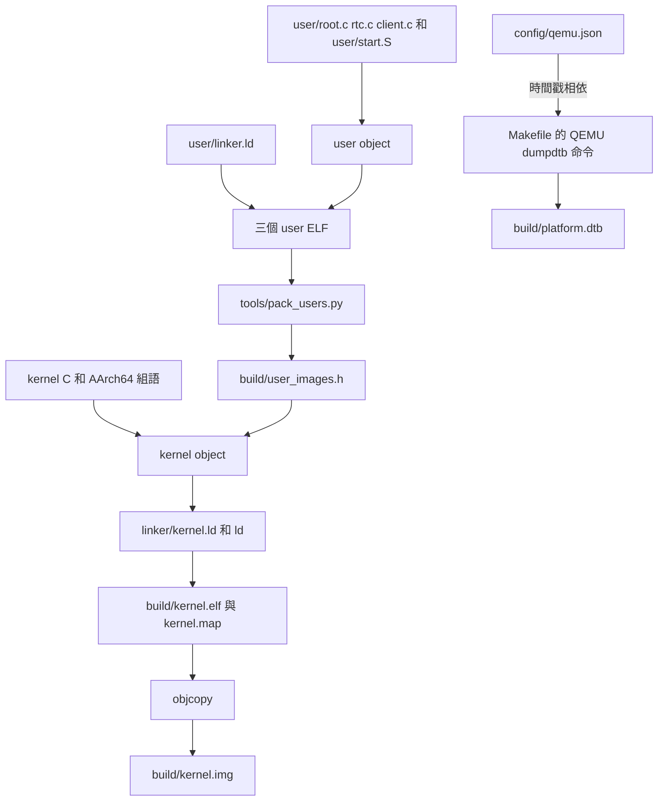
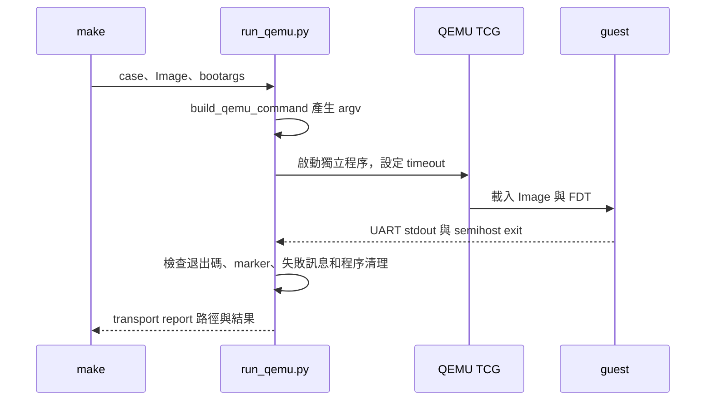

# 建置、映像與執行工具

本章從取得原始碼後的 WSL 環境開始，依序建立固定 user 映像、核心 ELF、raw Image 和 QEMU 使用的 Device Tree，最後追蹤一次實際啟動。閱讀時保留兩個問題：每個工具讀取及產生什麼？哪一個結果實際證明了 guest 的哪項行為？

以下指令在 WSL Ubuntu 的**專案根目錄**執行。需要先在終端機進入自己存放此專案的目錄；不要在 Windows 檔案系統中的另一份副本與 WSL 專案混用建置產物。此設定以 QEMU `virt`、AArch64 Cortex-A53、TCG、單 CPU、512 MiB 為目標，不依賴 KVM。

## 1. 先確認工具與環境

先列出專案需要的套件，這一步不安裝：

```bash
python3 tools/bootstrap.py
```

若工具缺少且使用 Ubuntu／Debian 環境，可執行：

```bash
python3 tools/bootstrap.py --install
```

`--install` 會執行 `apt-get update` 與安裝命令，必要時透過互動式 `sudo` 認證。它會變更 WSL 的套件狀態；帳號需要對應權限與可用的套件來源。密碼由終端機交給 `sudo`，不要寫入指令、腳本或文件。無安裝權限時可將缺少的套件與 preflight 訊息交給環境管理者處理。

```bash
python3 tools/preflight.py --profile target
aarch64-linux-gnu-gcc -dumpmachine
qemu-system-aarch64 --version
gdb-multiarch --version
dtc --version
```

`-dumpmachine` 的結果應指向 AArch64 交叉編譯目標；目前 Makefile 的工具名稱前綴是 `aarch64-linux-gnu-`。目標檢查除版本外也查詢 QEMU 所需能力。`Environment: READY (target)` 代表它找到所檢查的工具與能力，**不代表 guest 已開機或功能通過**；`BLOCKED` 應先讀清單中的原因。

| 工具 | 本專案用途 | 要分清的輸出 |
|---|---|---|
| host `python3`、`make`、`gcc` | 執行建置工具、測試與 host sanitizer 測試 | host 測試程式在 WSL 執行，不是 EL0 task |
| `aarch64-linux-gnu-gcc` | 將 C 與 AArch64 組語編譯成 object | object 尚未決定最終載入位置 |
| `aarch64-linux-gnu-ld` | 根據 linker script 連結 user 與 kernel ELF | ELF 含 entry、segment 與除錯資訊 |
| `aarch64-linux-gnu-objcopy` | 將 kernel ELF 轉成 raw Image | raw Image 不保留 ELF 的 symbol table |
| `qemu-system-aarch64`、`dtc` | 執行 guest、匯出與檢視 DTB | DTB 描述平台，不能單憑檔案推定程式已成功解析 |
| `gdb-multiarch` | 連接 QEMU GDB stub，讀取 ELF symbols | 必須使用與執行中 Image 相同建置的 ELF |

## 2. 建置哪些檔案

```bash
make all
```

第一次建立時，主要依賴關係如下。圖中的箭頭表示建置輸入到產物；`platform.dtb` 由 QEMU 的 DTB 匯出命令建立，不是由核心原始碼編譯出的檔案。



具體閱讀順序是 [Makefile](../../Makefile) 的 `all`、`build/user/%.elf`、`build/user_images.h`、`build/kernel.elf` 和 `build/kernel.img`。三個 user ELF 先由 `tools/pack_users.py` 驗證 entry、segment、對齊、範圍與 W+X 等條件；產生的 `build/user_images.h` 再被 `kernel/task.c` 編譯進核心。核心使用這些固定描述載入角色，並非在 guest 實作能載入任意 ELF 的通用 loader。

DTB 匯出規則將 `config/qemu.json` 列為 Make 相依檔，但實際的 dumpdtb 選項寫在 Makefile，並非執行時讀取該 JSON；QEMU 測試命令則由 `tools/qemu_command.py` 讀取 JSON。若修改平台設定，兩處必須一起核對，並重新驗證 DTB 與 guest。

| 產物 | 用途 | 檢查方式 |
|---|---|---|
| `build/user/root.elf`、`rtc.elf`、`client.elf` | 三個固定角色的 ELF | `aarch64-linux-gnu-readelf -lW build/user/rtc.elf` |
| `build/user_images.h` | 由 ELF 生成的 segment descriptor 與資料 | 以 `less build/user_images.h` 查看；不要手改產物 |
| `build/kernel.elf` | 帶 symbol 的核心 ELF，可供 GDB 使用 | `aarch64-linux-gnu-readelf -hW -lW build/kernel.elf` |
| `build/kernel.map` | linker 的 section 與 symbol 配置 | `less build/kernel.map` |
| `build/kernel.img` | QEMU `-kernel` 載入的 raw Image | `python3 tools/inspect_image.py build/kernel.img --json` |
| `build/platform.dtb` | 依本次設定匯出的平台 DTB | `dtc -I dtb -O dts build/platform.dtb -o build/platform.dts` |

`build/` 被 Git 忽略，是可重建的輸出與本機測試紀錄。要查看 Make 判斷還有哪些工作而不執行，使用 `make -n all`；若來源與產物都沒有變化，可能顯示 `Nothing to be done for 'all'`。`make rebuild` 透過 `make -B all` 強制重建，但保留原本的 reports；它不是清除目錄的指令。

## 3. 從編譯選項到入口位址

`Makefile` 使用 `-ffreestanding` 編譯，表示目標環境不必提供一般 hosted C 執行環境，入口也不必是 `main`。GCC 文件說明此選項隱含 `-fno-builtin`；Makefile 同時寫出兩者，實際連結的程式仍需自行提供所需函式，例如這裡的 `kernel/string.c`。`-g` 產生 GDB 所需除錯資訊；本專案也使用 `-O2`，所以原始碼單步不一定依文字順序，局部變數也可能被最佳化掉。[GCC 選項文件](https://gcc.gnu.org/onlinedocs/gcc/C-Dialect-Options.html)

`-MMD -MP` 產生 header 相依檔；Makefile 在後段 include kernel 和 user 的 `.d`。例如修改共用的 `include/uapi.h` 後，可先以 `make -n all` 觀察哪些 object、ELF 與 Image 會重建。若新增產物卻忘了宣告相依，舊產物可能被錯誤重用；實際曾發生的 user header 相依問題見[缺陷 006](../bugs.md)。

核心 linker script 將 `_start` 放在 `0x40080000`，並以 `PHDRS` 建立 RX、R、RW 的三個 `PT_LOAD`。`.bss` 是 `NOLOAD`，執行所需的記憶體大小因此可能大於 ELF 中對應 segment 的檔案大小。檢查：

```bash
aarch64-linux-gnu-readelf -hW -lW build/kernel.elf
aarch64-linux-gnu-nm -n build/kernel.elf | head -n 30
aarch64-linux-gnu-objdump -d build/kernel.elf | head -n 50
```

`readelf` 中的 entry 應與 linker script 一致；`Flg` 欄應反映三個 load segment 的權限。這些是 ELF 連結結果，CPU 執行時還要依頁表設定檢查；不能只靠 ELF flags 證明 MMU 權限。`PHDRS` 與 section／segment 的關係可查 [GNU ld 文件](https://sourceware.org/binutils/docs/ld/PHDRS.html)。

`objcopy -O binary` 產生的 `kernel.img` 不再是 ELF，因此使用 `readelf` 看 Image 並不適合；改用 `tools/inspect_image.py`。該工具檢查本專案限定的 64-byte header、magic、flags、branch 目標與大小，`VALID` 只表示通過這些格式檢查，不保證 guest 執行正確。Image header 的格式參照 [AArch64 boot protocol](https://docs.kernel.org/arch/arm64/booting.html)；這裡執行的是本專案核心。

## 4. 查看 QEMU 命令與執行結果

先只顯示會執行的 argv，不啟動 QEMU：

```bash
python3 tools/run_qemu.py --case p0-boot --image build/kernel.img \
    --boot-args case=p0-boot --dry-run
```

然後執行同一個個案：

```bash
make qemu TEST=p0-boot
```

命令由 `config/qemu.json` 和 `tools/qemu_command.py` 組合，使用 `-accel tcg`、`-machine virt,...`、`-cpu cortex-a53`、`-kernel` 和 `-append` 等參數。`-append` 傳入的 `case=p0-boot` 供 guest 選擇情境；`--case p0-boot` 則讓 harness 選擇預期 marker 與報告目錄。兩者不同時，程式可能執行與 harness 所期待的不同個案。



一次執行可觀察 `[BOOT] el=1`、`[PLATFORM]` 和 `[TEST] CASE=p0-boot PASS`。FDT 位址與裝置欄位應從該次輸出、設定和 DTB 比對；不要將其他 QEMU 設定的數值硬套進來。測試 profile 的 semihosting 限 privileged 執行，guest 以此回報退出狀態。參數原義可查 [QEMU 命令列文件](https://www.qemu.org/docs/master/system/invocation.html)。

輸出末尾的 `report` 是該次 `build/reports/qemu/<case>/<時間與識別碼>/report.json`；旁邊有 `stdout.log` 和 `stderr.log`。這些檔案會記錄命令列與本機路徑，分享前須自行檢查。trace 的第一個觀測點是 guest 輸出；報告是 host 根據程序與輸出做的檢查。

## 5. 由一次執行追到驗證程式

在 [tools/run_qemu.py](../../tools/run_qemu.py) 依序閱讀 `main()`、`run_case()`、`execute()` 與 `inspect_logs()`；再到 [tools/qemu_command.py](../../tools/qemu_command.py) 看 `build_qemu_command()`。`run_case()` 建立獨立報告目錄並記錄命令，`execute()` 啟動並等待程序，`inspect_logs()` 讀取已保存輸出。timeout 或中斷時會處理原 process group；報告亦檢查殘留程序。

單獨的 `make qemu` 是 transport 檢查。要驗證 P0 的 Image 與 guest 平台欄位，再執行：

```bash
make test-p0
python3 -m json.tool build/reports/gates/p0-image.json
python3 -m json.tool build/reports/gates/p0-boot.json
python3 tools/phase.py check P0
```

這會執行 P0 所需的 host FDT 測試及 P0 validator；`p0-image` 檢查 Image，`p0-boot` 將 guest 輸出與匯出的 DTB 做個案比對。完整回歸可使用 `make test`，依序執行工具測試、host 測試與 P0–P7 validator。請區分：

1. `make check` 驗工具與文件連結，不證明 guest 的 MMU 或 IRQ。
2. `make qemu TEST=p0-boot` 的 PASS 是程序、marker 與清理條件通過；報告有 `semantic_validation=false`。
3. P0 validator 另檢查實際欄位，才建立 phase gate 收據；其他 phase 依各自 validator 和案例檢查。
4. `phase.py` 驗收據欄位、證據 hash、來源指紋與前置狀態，並不代替個案 validator 分析輸出。

來源與維護文件的變更可能讓既有收據顯示 `STALE`；raw evidence hash 不符或失敗收據會顯示 `INVALID`。應重新執行相關 validator 並檢查結果，不可手改收據宣稱通過。

## 6. 互動追蹤與常見問題定位

如需在啟動時觀察，使用兩個終端。第一個終端：

```bash
make all
python3 tools/debug_qemu.py --case p0-boot
```

第二個終端，在相同的專案根目錄：

```bash
gdb-multiarch -q -x tools/gdbinit
```

QEMU 以 `-S` 暫停，預設 GDB stub 只監聽本機 port 1234。連線後可使用 `break kernel_main`、`continue`、`info registers`、`bt`、`disassemble /m kernel_main`；如果切換 `--port`，GDB target 也須跟著變更。`tools/gdbinit` 載入 `build/kernel.elf` 並設定 `panic` 斷點。EL0 與 exception 的具體追蹤範例見 [00 執行與追蹤](00-tracing.md)。

| 症狀 | 先檢查 | 下一步 |
|---|---|---|
| 找不到交叉編譯器 | `python3 tools/preflight.py --profile target` 與 Makefile 的 `CROSS` | 在 WSL 安裝相符工具；不要只安裝 Windows 端工具 |
| `make` 認為不需重建，但 header 曾修改 | 比對 object 的 `.d`、Makefile 的 include 與 `make -n all` | 先定位缺少的相依；需要重建時用 `make rebuild` |
| 沒有 UART 輸出 | QEMU 實際 argv、Image、exit code、stderr、FDT 解析與 UART 初始化先後 | 在 `kernel_main` 或更早入口設斷點；不要把 timeout 直接當作 UART 硬體故障 |
| `kernel.elf` 有 symbol，GDB 卻停在奇怪位置 | 執行中 Image 與 ELF 是否同次建置，GDB target 是否正確 | 重新建置兩者並重新連線；`-O2` 仍可能使 C 行與指令順序不同 |
| transport PASS，但 phase 未通過 | `report.json` 的證據種類、gate 收據 assertions、raw logs | 執行對應 `make test-pN`，查看具體失敗欄位與來源指紋 |
| `p0-boot` exit 非零且 UART 尚未初始化 | FDT pointer、header／reserve map、`platform_parse()` 結果 | 依 `docs/bugs.md` 重現相關輸入，不憑沒有 log 斷定單一原因 |

## 7. 自問自答

**問：為什麼有 `kernel.elf`，還要產生 `kernel.img`？**

答：ELF 保留 section、program header 與 symbols，適合檢視和 GDB；目前 QEMU 的 `-kernel` 使用本專案產生的 raw Image。兩者必須來自同次建置，否則 symbol 位址不一定對應執行中的指令。

**問：為什麼 `image_size` 可以大於 raw 檔案大小？**

答：header 中的有效記憶體大小包含執行時需要的 BSS 等區域；raw 檔案不必存放整個零初始化區。入口組語在進入 C 前會清除 linker symbols 指定的 BSS 範圍。

**問：`make check` 成功後，還要不要執行 QEMU？**

答：若要驗證 guest 功能，仍然需要。`make check` 是工具、設定和文件的檢查；例如中斷到達、頁表存取限制與 EL0/EL1 轉換必須由對應 guest 案例觀察。

**問：為什麼重新執行測試後，同一份舊收據可能變成 INVALID？**

答：收據指向的原始檔案若被更新，儲存的 hash 不再相符；若只有來源指紋不同，狀態可能為 STALE。執行對應 validator 產生與目前來源及實際證據一致的收據，再檢查前置階段。
