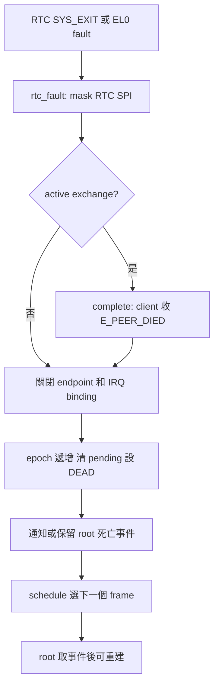
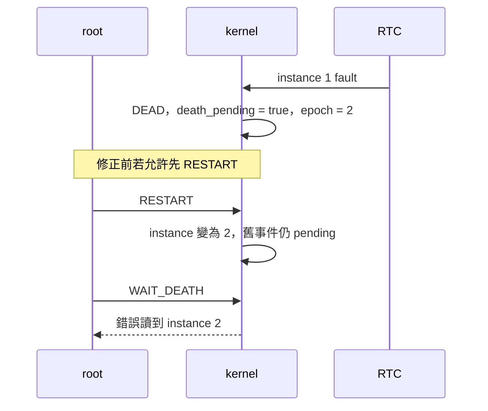
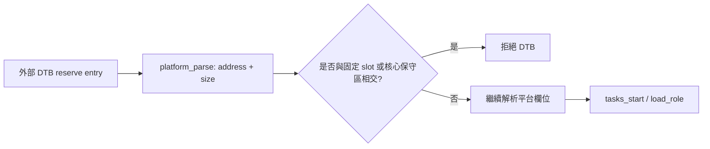

# 從症狀到修正：四個除錯案例

讀取錯誤訊息後，先釐清哪個元件提出觀察，再列出能用資料區分的原因。一次只變更必要條件，保留執行命令、輸出及版本；修正後用同一類觸發條件驗證。以下案例均來自 [缺陷紀錄](../bugs.md)：修正前輸出是歷史紀錄，現在執行的命令則驗證現有版本。


下文命令都在 WSL 的專案根目錄執行，先使用 `make all` 建置。輸出中的 instance、epoch 是所選案例的資料；堆疊、ELR 位址和行號可能隨編譯改變。

## 案例一：RTC 結束後核心發生 `dead RTC exposed`

### 症狀和要檢查的條件

修正前，RTC 完成 READY 且接收 client RPC 後執行 `SYS_EXIT`，guest 印出 `[PANIC] dead RTC exposed` 並以非零結束。見 [當時的 UART 紀錄](../evidence/rtc-exit-before.log)。這個訊息來自 `kernel/task.c` 的 `invariant()`：RTC 已為 `T_DEAD`，但 `rtc_masked` 不是 true 或 `endpoint_ready` 仍為 true。

僅憑這個 panic，不能直接判定是 IRQ handler 或裝置暫存器出錯。先提出可區分的方向：

| 假設 | 下一步檢查 | 能說明什麼 |
|---|---|---|
| RTC 已設為 DEAD，但 endpoint 仍開啟 | 查看 `task[1].wait.state` 和 `endpoint_ready`，往回查 `SYS_EXIT` | 是否有狀態已死亡、外部仍可送請求的不一致 |
| 死亡時沒有遮蔽 RTC SPI | 查看 `rtc_masked`，追 `irq_disable(plat.rtc_irq)` 的呼叫 | 軟體紀錄的 mask 狀態是否已更新；不能單靠此值代替實際 GIC 暫存器查證 |
| 遺漏還在等待的 client | 查看 `rpc.active` 與 client 的 `T_REPLY` | 是否仍有 outstanding call；需再對照 `complete()` 的結果 |

當時另一個定位方式是在 GDB 於 RTC 的 RECV 入口，將保存的 syscall 編號改成 EXIT。這是**刻意改寫現場的重現手法**，不是原本程式自然送出 EXIT 的證明；[當時的 GDB 紀錄](../evidence/rtc-exit-gdb.log)顯示改寫前 syscall 為 5，之後程序非零退出。以 GDB 改值可能引入其他影響，必須再對照未注入的 `p6-exit` 症狀。

### 根因與修正路徑

舊路徑只把 RTC 改為 `T_DEAD`，沒有執行 endpoint、IRQ binding 與等待中的 client 的清理；到 scheduler 做 invariant 檢查時才偵測到不一致。現在 `SYS_EXIT` 對 RTC 呼叫 `rtc_fault()`，與 EL0 fault 使用同一組清理步驟：



沿 [`SYS_EXIT` 和 `rtc_fault()`](../../kernel/task.c) 找到每一步。`complete()` 以舊 epoch 先結束 active exchange，然後 `rtc_fault()` 才增加 epoch。重設 RTC stack 發生在 root 執行 `SYS_RESTART` 後的 `load_role()`；此時不能把 fault 發生時正在使用的 stack 直接當成可立即清除。

### 現在如何檢查

```sh
make qemu TEST=p6-exit
make test-p6
```

前者的 transport report 應不含 panic 且有 PASS；在輸出對照 `[DEATH]`、`[REBUILD]` 與 `[RESTART]`。`make test-p6` 另外檢查事件數量、順序、instance／epoch 和其他語意。這個案例驗證固定 RTC 角色的 EXIT／重啟；不代表任意服務或任意故障位置都已涵蓋。

## 案例二：事件還沒取走，重啟後死亡 instance 改變

### 先畫出兩個次序

死亡事件儲存在核心的 `death_pending`，root 使用 `SYS_WAIT_DEATH` 取得內容。修正前存在一條次序：root 尚未取事件時先重啟，增加 `task[1].instance`；之後 `WAIT_DEATH` 才讀目前 instance，誤把新的 instance 當成死亡者。



一份隔離副本曾讓 root 先睡眠，等 RTC fault 留下事件後先做 RESTART，再做 WAIT_DEATH；[建置與輸出紀錄](../evidence/death-event-before-source.log)顯示 instance 1 死亡、instance 2 重建後測試以 `[USER_FAIL]` 結束。該紀錄的本機路徑已匿名化。這份輸出能顯示重建早於測試失敗；事件欄位如何改變還需看程式或另一份 GDB 觀察。

[GDB 紀錄](../evidence/death-event-before-gdb.log)是在 RESTART 入口**手動注入** `death_pending=1`，再觀察後續 WAIT_DEATH：pending 仍為 1，但 instance 已變 2。這個方法有助釘住狀態；它與上述未使用 GDB 改值的隔離副本是兩種不同實驗。兩者都不代表目前版本仍有此缺陷。

### 追蹤資料來源

對照 [`rtc_fault()`、`SYS_WAIT_DEATH` 和 `SYS_RESTART`](../../kernel/task.c)：

1. RTC 死亡後，若 root 尚未等待，`death_pending` 保留事件；若 root 已在 `T_DEATH`，核心直接寫入 root frame 的返回欄位並喚醒它。
2. `SYS_WAIT_DEATH` 消費 pending 事件時，將目前 RTC 的 `instance` 與 `epoch` 寫入 root frame 的 x1、x2，然後清 `death_pending`。
3. 目前 `SYS_RESTART` 在 RTC 已 DEAD 但事件仍 pending 時回 `E_BUSY`。root 取走事件後才允許重建並遞增 instance。

這裡選擇限制次序，避免增加另一份事件儲存結構。它依賴「單一 RTC 角色、事件尚未取走時不重啟」的目前設計，不能推廣成通用事件佇列。

### 現在如何檢查

```sh
make qemu TEST=p6-event
make test-p6
```

在 `p6-event` 對照 `[DEATH]` → `[RESTART_WAIT] instance=1 epoch=2` → `[REBUILD] instance=2 epoch=2`。測試程式還檢查第一次 RESTART 的回傳值為 `E_BUSY`，接著取到 instance 1／epoch 2，再成功重啟。`p6-event` 的 root 等待 200 ms 以建立測試次序；不要把這個數字解讀成系統的最大反應時間。

## 案例三：FDT 保留區和固定 task slot 重疊

### 症狀與根因

FDT 的 reserve map 描述呼叫端不應另行使用的實體記憶體；每筆是 address 和 size，`(0, 0)` 為結尾。修正前，把三個固定 slot 所在區域標成保留後，parser 只檢查 reserve map 的格式，沒有檢查是否與後續要配置的區域相交。guest 繼續呼叫 `load_role()`，將映像資料寫入已宣告保留的區域。



目前 [`kernel/fdt.c`](../../kernel/fdt.c) 先檢查 size 和 64-bit 加法溢位，再以 `reserved_conflicts()` 比對兩個半開區間：核心保守區 `[0x40080000, 0x40200000)` 與固定 slot `[0x41000000, 0x41060000)`。半開區間的結束位址不包含在區間內，所以從 `0x41060000` 開始的保留區與 slot 相鄰但不重疊。

觀察順序很重要：`boot_entry` 會在 `platform_parse()` 前清 BSS。對與核心映像重疊的保留區，即使 parser 現在拒絕，也不能聲稱防止了所有更早的載入或寫入。DTB reserve map 的結構可對照 [Devicetree Specification](https://devicetree-specification.readthedocs.io/en/stable/flattened-format.html#memory-reservation-block)；本專案支援範圍仍以 parser 為準。

### 用 host fixture 驗證邊界

```sh
make test-host
```

在 [`tests/host/test_fdt.c`](../../tests/host/test_fdt.c) 找 `test_reservations()`：它檢查區間首尾單 byte 重疊、相鄰、非重疊及加法溢位。測試在 host 以 ASan／UBSan 執行真實 parser；這證明的是 parser 對 fixture 的結果，並不直接證明 guest 的每個載入路徑。

接著可在 `build/fdt-example/` 建立自訂 DTB，讓保留區覆蓋固定 slot，再使用相同的 QEMU profile 啟動：

```sh
python3 - <<'PY'
from pathlib import Path
import subprocess
from tools.qemu_command import build_qemu_command, load_config

folder = Path('build/fdt-example')
folder.mkdir(parents=True, exist_ok=True)
original = subprocess.run(
    ['dtc', '-I', 'dtb', '-O', 'dts', 'build/platform.dtb'],
    check=True, text=True, capture_output=True,
).stdout
if '/dts-v1/;' not in original:
    raise SystemExit('DTS header missing')
source = original.replace(
    '/dts-v1/;', '/dts-v1/;\n/memreserve/ 0x41000000 0x60000;', 1,
)
(folder / 'overlap.dts').write_text(source, encoding='utf-8')
subprocess.run(
    ['dtc', '-I', 'dts', '-O', 'dtb', '-o', str(folder / 'overlap.dtb'),
     str(folder / 'overlap.dts')], check=True,
)
command = build_qemu_command(
    load_config(), Path('build/kernel.img'), boot_args='case=p0-boot',
)
result = subprocess.run(command + ['-dtb', str(folder / 'overlap.dtb')], timeout=15)
print('QEMU exit status:', result.returncode)
if result.returncode != 2:
    raise SystemExit('unexpected exit status')
PY
```

目前版本拒絕此 DTB，範例印出 `QEMU exit status: 2`。轉回 DTB 時 `dtc` 可能對其他節點提出 warning；應逐項閱讀，不能因出現 warning 就認定是此 reservation 檢查的結果。這個命令只檢查 guest 退出碼；host fixture 提供其他邊界的解析檢查。曾另以相鄰且不重疊的 reservation 驗證可正常啟動。若沒有 UART 輸出，先確認退出碼與是否進入 `console_init()`，不要假設 guest 一定死鎖。

## 案例四：入口位址存在，但指令內容不完整

### 從資料界線找原因

host 的 `tools/pack_users.py` 驗證固定 user ELF。修正前條件只要求 entry 落在 executable segment 的檔案 bytes 內，沒有確認 entry 開始的四個 bytes 都存在。AArch64 指令為 4 bytes：例如 segment 只有 1 byte、entry 指向開頭時，舊條件雖成立，後面三個 bytes 並不來自檔案。

```text
舊條件：segment.va <= entry < segment.va + file_size
新條件：segment.va <= entry 且 entry + 4 <= segment.va + file_size
另外仍須檢查 entry 4-byte 對齊及 segment 可執行。
```

載入時 segment memory 中未由檔案提供的尾端會被清零；不能把「entry 指到檔案中的第一 byte」當成「完整指令已提供」。這是在合成輸入上發現的 host 驗證邊界缺陷，沒有證據顯示既有固定 ELF 曾因它執行錯誤。

### 現在如何檢查

```sh
python3 -m unittest tests.test_pack_users.PackUsersTests.test_entry_requires_complete_instruction_in_file -v
```

測試將 fixture 的 segment `p_filesz` 分別設為 1、2、3，要求 `read_image()` 拒絕；完整 4 bytes 的原 fixture 應被接受。若測試失敗，先分清是 fixture 的 `filesz`／`memsz` 不合法，還是 entry 檢查本身沒有拒絕。固定 ELF 建置與 guest 執行要另行驗證，不能由這個 host 測試代替。

## 自問自答

**問：使用故障注入是否就代表找到真實缺陷？**

答：不是。注入用來建立測試條件；只有觀察到不符合契約的行為、定位到原因並驗證修正，才能將該問題整理成缺陷。案例二的 GDB 注入與隔離副本是分開的證據。

**問：為什麼同時保留 UART、GDB 與退出碼？**

答：UART 提供事件和 invariant 訊息，GDB 可檢查某一停點的暫存器或狀態，退出碼表明程序如何結束。各自只能支持部分結論；GDB 的暫停與改值也可能改變後續時序。

**問：讀 GIC 的 IAR 能否在 GDB 隨時重複？**

答：不應為了看值額外重讀，因為讀取會影響 active state；應在 handler 已讀取後觀察其保存的 `id`。以 `-O2 -g` 建置時，局部變數可能顯示為 optimized out，必要時對照組語或調整斷點。參見 [GDB 最佳化程式說明](https://sourceware.org/gdb/current/onlinedocs/gdb.html/Optimized-Code.html)。
