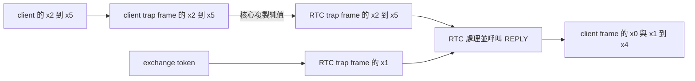
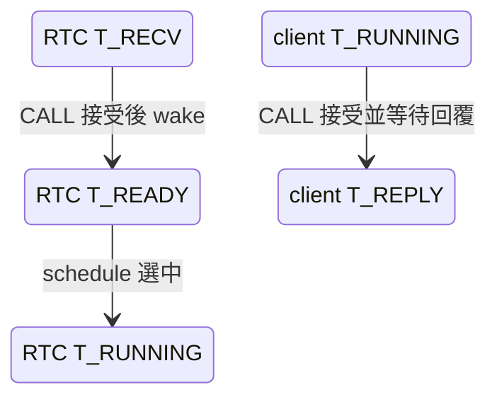
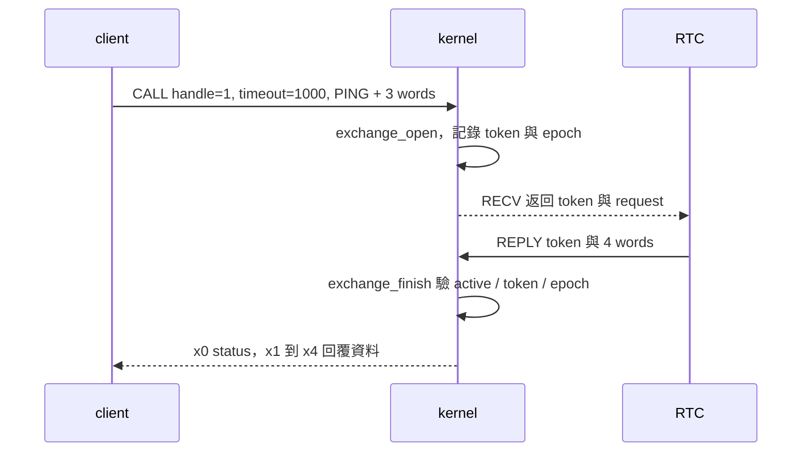

# 程式碼精讀：一筆 PING 如何往返

本章只追 `p4-ipc` 中一筆成功的 PING。先沿原始碼確認資料的來源、保存位置及完成條件，再用 GDB 驗證兩個時間點。建議先讀[排程與 IPC](02-scheduling-ipc.md)；本章的暫存器名稱與數值依本專案 ABI，不代表所有系統都使用相同編號。

## 1. 先預測資料如何移動

`check_ping()` 要求 RTC 原樣回傳四個 word：操作碼 `RTC_PING`、`0x11`、`0x22`、`0x33`。假設 RTC 已經在 `T_RECV`，請先預測：client 執行 SVC 前這四個值在哪些暫存器？RTC 被喚醒後，token 與資料又放在哪裡？



方框代表保存資料的位置；箭頭表示核心複製或程式使用資料。兩個 task 沒有因此共用一個 user buffer。

## 2. 從呼叫端到 SVC

[user/common.h](../../user/common.h) 的 `check_ping()` 呼叫 `ping_ready()`；後者使用下列呼叫。這裡的 1000 是 client timeout，單位毫秒。

```c
result = rpc(1000, RTC_PING, 0x11, 0x22, 0x33);
```

`rpc()` 再呼叫 `user_call(SYS_CALL, boot->endpoint, timeout, op, a, b, c)`。`user_call()` 位於 [include/uapi.h](../../include/uapi.h)，將 syscall 編號放入 x8、六個參數放入 x0–x5，執行 `svc #0`。對本次 PING，SVC 入口值是：

| 暫存器 | 本次值 | 意義 |
|---|---:|---|
| x8 | `4` | `SYS_CALL` |
| x0 | `1` | endpoint handle |
| x1 | `1000` | client timeout，毫秒 |
| x2 | `2` | `RTC_PING` |
| x3、x4、x5 | `0x11`、`0x22`、`0x33` | 其餘三個資料 word |

SVC 進入 exception vector；[vectors.S](../../arch/aarch64/vectors.S) 的 `SAVE 0` 保存暫存器與 exception 暫存器，將 frame pointer 交給 C 函式。`task_exception()` 先處理已到期 deadline，再依 ESR、SPSR 判斷 SVC，呼叫 `syscall()`。

## 3. 接受 request 並切換角色

對照 [kernel/task.c](../../kernel/task.c) 的 `SYS_CALL` 分支，依序檢查 handle／rights、timeout、RTC 是否死亡或未就緒、RTC 是否正在 `T_RECV`，以及是否已有 active exchange。通過後的關鍵操作是：

```c
if (!exchange_open(&rpc, current, epoch)) { result(current, E_LIMIT); break; }
task[1].frame->x[1] = rpc.token;
for (unsigned n = 0; n < 4; ++n) task[1].frame->x[n + 2] = a[n + 2];
wake(1, E_OK);
move(current, T_REPLY, deadline);
```

摘錄省略了統計與其他分支，完整順序以原始碼為準。`exchange_open()` 位於 [kernel/state.c](../../kernel/state.c)：它在 active 為 false、sequence 未耗盡且 epoch 有效時，遞增 sequence 作為 token，並保存 client 和 epoch。接著核心把 token 放進 RTC frame 的 x1，將 request 的四個 word 放進 RTC frame 的 x2–x5，使 RTC 變成 `T_READY`、client 變成帶 deadline 的 `T_REPLY`。

此時程式還在 EL1，並非 `wake()` 執行完就直接跳到 RTC。`syscall()` 返回後，`schedule()` 才選擇 READY task、切換頁表並回傳其 frame；組語根據該 frame 恢復暫存器，再以 `eret` 進入所選 task。



上圖將兩個 task 的狀態畫在一起，方便對照；每條箭頭各自屬於一個 task，不表示 RTC 的狀態直接變成 client 的狀態。

## 4. 服務如何回覆

RTC 在 [user/rtc.c](../../user/rtc.c) 從 `SYS_RECV` 返回後讀取 `request.word[0]` 的 token、`word[1]` 的操作碼及後續資料。因 `user_call()` 把回傳 x1–x5 對應到 `word[0..4]`，前述 frame 資料到 RTC 時的對照如下：

| RTC 看到的欄位 | 來源 | 本次值 |
|---|---|---:|
| `request.word[0]` | 返回 x1 | token，依當次 sequence 而定 |
| `request.word[1]` | 返回 x2 | `RTC_PING` |
| `request.word[2..4]` | 返回 x3–x5 | `0x11`、`0x22`、`0x33` |

PING 分支保留原本四個資料值，呼叫 `SYS_REPLY`。核心 `complete()` 將 token 和目前 epoch 交給 `exchange_finish()`；只有 active、token 和 epoch 符合時，才將回覆寫入 client frame，並喚醒 client。成功後 active 變成 false；晚到的舊 token 無法再完成已結束的 exchange。



client 的 `user_call()` 將 x0 轉為 `status`，x1–x5 存為 `word[0..4]`。`check_ping()` 分別驗證 syscall status 和四個 word；服務錯誤若放在 reply 的第一個 word，與 syscall status 是不同欄位。

## 5. 用 GDB 核對兩個時間點

第一個 WSL terminal 在專案根目錄執行：

```sh
make all
python3 tools/debug_qemu.py --case p4-ipc
```

第二個 terminal 執行 `gdb-multiarch -q -x tools/gdbinit`。以下假設剛啟動且 `tools/gdbinit` 的 panic breakpoint 編號是 1；若已設定其他 breakpoint，先用 `info breakpoints` 查實際編號。輸入：

```gdb
break *task_exception if current == 2 && $x1 == 0 && ((struct trap*)$x0)->x[8] == 4 && ((struct trap*)$x0)->x[0] == 1 && ((struct trap*)$x0)->x[2] == 2
continue
set $tf = (struct trap*)$x0
p/x $tf->x[0]@6
p task[1].wait
p rpc
```

斷在 `task_exception` 第一條指令時，`x0` 是 frame pointer，`x1` 是 kind。條件限定 client、同步例外、`SYS_CALL`、endpoint 1 與 `RTC_PING`；`p4-ipc` 先執行其他錯誤 handle 測試，因此不能把未加條件的第一個 CALL 直接當作 PING。

在目前版本的一次實際執行中，六個參數顯示 `{0x1, 0x3e8, 0x2, 0x11, 0x22, 0x33}`，RTC 為 `T_RECV`，exchange 為 inactive。`0x3e8` 是十進位 1000。deadline 是 counter ticks，數值隨執行而變；這個斷點在處理 CALL **之前**，因此 token 尚未建立。

接著觀察成功 REPLY 到達共同完成點的入口：

```gdb
delete 2
break *complete if $x1 == 0
continue
p rpc
p task[2].wait
delete 3
continue
```

本例 `complete()` 的第二個參數是 status，函式入口的 x1 為 0 表示此處的 `E_OK`。一次實際執行中，`rpc.active` 是 true、token 為 1、client 為 `T_REPLY`；這些是 `exchange_finish()` 執行**之前**的狀態。token 和 breakpoint 編號取決於本次執行與 GDB 設定，不是固定保證。最後 `continue` 應讓案例正常退出。

專案使用 `-O2 -g`：最佳化可能讓區域變數顯示為 `<optimized out>`，source line 的單步順序也可能與指令不同。觀察 GDB 或 UART 之前，先用 `make all` 保持 `build/kernel.elf` 與 `build/kernel.img` 同一次建置。若斷點未命中，用 `info breakpoints` 和 `disassemble /m complete` 檢查符號與條件；參考 [GDB 條件斷點](https://sourceware.org/gdb/current/onlinedocs/gdb.html/Set-Breaks.html)及[最佳化程式](https://sourceware.org/gdb/current/onlinedocs/gdb.html/Optimized-Code.html)。

## 6. 自問自答

**如果 RTC 已經收到 request，但 client timeout 先完成，RTC 的 token 還能回覆嗎？**

不能再完成該筆 exchange。`expire()` 經 `complete()` 把 client 喚醒並使 exchange inactive；RTC 之後送出舊 token 時得到 `E_STALE`。RTC 仍需完成自己的裝置清理；可用 `make qemu TEST=p5-client-timeout` 觀察對應案例。

**如果 CALL 遇到 `E_BUSY`，核心會把 request 放到 queue 等待嗎？**

不會。此版沒有 send queue。`SYS_CALL` 在 RTC 不處於 `T_RECV` 或已有 active exchange 時直接回傳 `E_BUSY`；是否稍後重試由呼叫者依操作語意決定。

**GDB 停在 `complete()` 入口時，是否已經完成 request？**

尚未。這時只到達 `exchange_finish()` 之前；要判斷是否完成，仍須看驗證結果、active 變化與 client 的 frame／狀態。GDB 暫停也會改變觀察時序，不能用單步耗時當作延遲測量。
